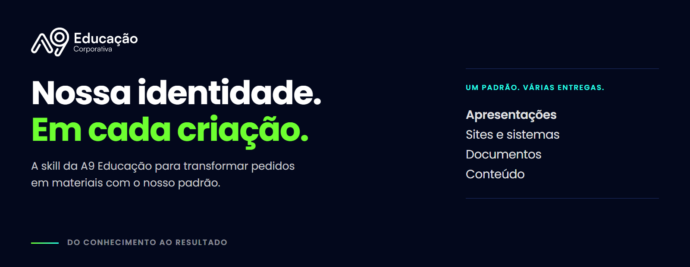
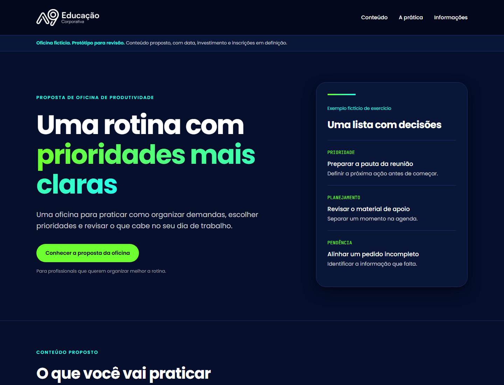
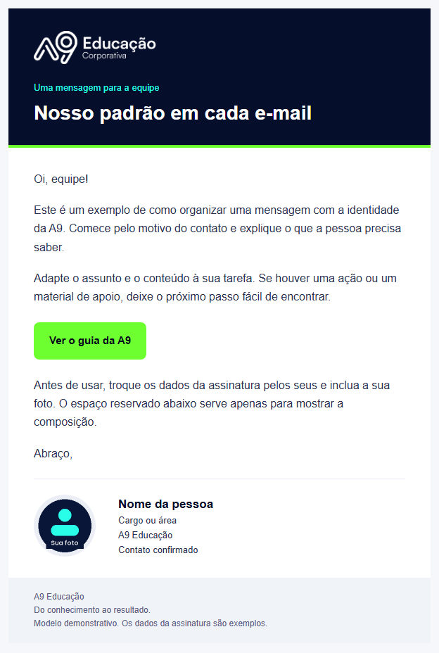

<h1 align="center">A9 Educação · Skill de marca e criação</h1>

<p align="center">Apresentações, sites, documentos e conteúdo com a identidade da A9.<br>Um pacote com nossas fontes, cores, logos, referências e prompts para o trabalho.</p>

<p align="center">
  <a href="https://github.com/mauriciokruger/a9-educacao/releases/download/v1.1.0/a9-educacao-v1.1.0.zip"></a>
  <a href="#instalação"></a>
  <a href="#exemplos-criados-com-a-skill"></a>
</p>

<p align="center"><strong>v1.1.0</strong> · Poppins + JetBrains Mono · Logos oficiais · 27 prompts · HTML sem internet</p>

Use no ChatGPT, Claude ou em ambientes locais compatíveis com Agent Skills. A instalação e os recursos disponíveis dependem da plataforma e da conta.

## Sobre a skill

Você conta o que precisa criar, para quem é o material e qual é o objetivo. A skill ajuda a IA a seguir as fontes, cores, logos e o jeito de comunicar da A9, sem precisar explicar tudo de novo em cada pedido.

Ela reúne os guias da marca, modelos de apresentação e 27 pedidos prontos para adaptar à sua rotina. O resultado continua passando pela sua revisão antes de ser usado ou compartilhado.

## Exemplos criados com a skill

Uma apresentação de seis slides sobre como pedir materiais à IA, criada usando os arquivos da skill instalada. Fontes, logo, navegação e impressão estão no próprio HTML.

[](docs/exemplos/primeiro-pedido-a9.pdf)

| Experimente | Arquivos |
| --- | --- |
| **Seu primeiro pedido com a A9**. Apresentação de seis slides | [Baixar HTML navegável](https://github.com/mauriciokruger/a9-educacao/releases/download/v1.1.0/primeiro-pedido-a9.html) · [Ver PDF](docs/exemplos/primeiro-pedido-a9.pdf) |
| **Oficina de produtividade**. Landing page responsiva, fictícia | [Baixar HTML](https://github.com/mauriciokruger/a9-educacao/releases/download/v1.1.0/oficina-produtividade.html) |
| **Biblioteca de composição**. Oito tipos de slide para adaptar | [Baixar HTML](https://github.com/mauriciokruger/a9-educacao/releases/download/v1.1.0/demo-a9.html) · [Ver PDF](docs/demo-a9.pdf) |

<details>
<summary>Ver a prévia da landing page</summary>



O exemplo mantém data, investimento e inscrições como pendentes. Todos os dados são demonstrativos.

</details>

Baixe os HTMLs e abra no navegador. O GitHub mostra o código do arquivo. A apresentação interativa funciona depois do download. As fontes e a logo já estão incorporadas.

## Comece aqui

1. [Baixe a skill pronta para instalar](https://github.com/mauriciokruger/a9-educacao/releases/download/v1.1.0/a9-educacao-v1.1.0.zip).
2. Siga abaixo as instruções da sua plataforma.
3. Abra uma conversa e peça um material.

> Use a skill A9 Educação para criar uma apresentação de 8 slides sobre revisão de respostas de IA, para nossa equipe. Use apenas exemplos fictícios.

Baixar o repositório não instala a skill. Para instalar, use o ZIP da release, que contém somente a pasta a9-educacao com suas referências e assets. O botão Code / Download ZIP do GitHub baixa o projeto inteiro e não é o pacote de instalação.

## O que está incluído

| Material | Para que serve |
| --- | --- |
| [Contexto e Regras](skills/a9-educacao/references/Contexto%20e%20Regras.md) | Contexto institucional, tom de voz e uso de informações |
| [Design System](skills/a9-educacao/references/Design%20System.md) | Cores, fontes, logos e aplicações por superfície |
| [Prompts por Setor](skills/a9-educacao/references/Prompts%20por%20Setor.md) | 27 comandos práticos em nove áreas |
| [Apresentações](skills/a9-educacao/references/Apresenta%C3%A7%C3%B5es.md) | Composição de slides, navegação e exportação |
| [E-mails e Assinaturas](skills/a9-educacao/references/E-mails%20e%20Assinaturas.md) | E-mail no padrão A9 e assinatura com foto do remetente |
| [Instruções da skill](skills/a9-educacao/SKILL.md) | Ativação e escolha das referências |
| [Modelo HTML](skills/a9-educacao/assets/apresentacoes/modelo-a9.html) | Base editável com oito tipos de slide |
| [Demonstração HTML](skills/a9-educacao/assets/apresentacoes/demo-a9.html) | Exemplo completo de oito slides com dados fictícios |
| [Demonstração em PDF](docs/demo-a9.pdf) | Consulta rápida ao resultado de impressão |
| [Modelo de e-mail](skills/a9-educacao/assets/emails/modelo-a9.html) | Cabeçalho com logo, corpo claro, botão e assinatura com foto |
| [Modelo de assinatura](skills/a9-educacao/assets/emails/assinatura-a9.html) | Base para preencher com nome, área, contatos e foto autorizados |

Para abrir um HTML localmente, baixe o arquivo e abra no navegador. A visualização de código do GitHub não executa a apresentação. [Arquivos da release](https://github.com/mauriciokruger/a9-educacao/releases/tag/v1.1.0) também incluem o HTML e o PDF separadamente.

## Instalação

Escolha onde você vai usar a skill. [ChatGPT](#instalar-no-chatgpt) · [Claude](#instalar-no-claude) · [Codex / Claude Code](#instalar-no-codex-ou-claude-code) · [Projeto com arquivos](#alternativa-com-arquivos-em-um-projeto).

A instalação no **Codex foi testada neste computador**, com a skill reconhecida e usada para criar os exemplos acima. O upload nativo em ChatGPT e Claude ainda não foi testado. [Veja as verificações e os limites](docs/VALIDACAO.md).

## Instalar no ChatGPT

Se a sua conta tiver o recurso Skills, siga estes passos.

1. Abra Plugins e a aba Skills.
2. Selecione Create e Upload from your computer.
3. Envie a9-educacao-v1.1.0.zip.
4. Aguarde a análise do arquivo e conclua a instalação/habilitação apresentada.
5. Abra uma conversa e selecione a skill com @ quando disponível, ou peça explicitamente seu uso.

Algumas contas usam nomes de menus diferentes. Em workspaces, permissões de administrador podem limitar criação, instalação e compartilhamento. Não é necessário fornecer uma chave de API para usar esta skill.

Se o recurso não aparecer, use a alternativa por Projeto descrita abaixo. Não há garantia de instalação nativa em todo plano ou superfície.

[Instruções oficiais de Skills no ChatGPT](https://help.openai.com/en/articles/20001066-skills-in-chatgpt)

## Instalar no Claude

1. Verifique se execução de código e criação de arquivos estão habilitadas na sua conta ou organização.
2. Abra Customize / Skills.
3. Clique em +, Create skill e Upload a skill.
4. Envie a9-educacao-v1.1.0.zip sem descompactar.
5. Habilite a skill e peça explicitamente seu uso na primeira conversa.

Em Team ou Enterprise, a organização pode limitar criação e compartilhamento. Se o menu não existir, confira as configurações com quem administra o workspace.

[Instruções oficiais de Skills no Claude](https://support.claude.com/en/articles/12512180-use-skills-in-claude)

## Instalar no Codex ou Claude Code

Descompacte o ZIP e copie a pasta a9-educacao inteira, preservando as subpastas.

| Ambiente | Pasta para uso pessoal | Pasta de um projeto |
| --- | --- | --- |
| Codex | ~/.agents/skills/a9-educacao | .agents/skills/a9-educacao |
| Claude Code | ~/.claude/skills/a9-educacao | .claude/skills/a9-educacao |

No Windows, ~ representa sua pasta de usuário. Não mantenha cópias duplicadas da skill em várias pastas do mesmo ambiente.

No Codex, use $a9-educacao ou selecione em /skills. No Claude Code, confira a lista de skills e peça o uso de A9 Educação. Se uma instalação ou atualização não aparecer, reinicie o aplicativo ou a sessão.

O Codex também oferece um instalador. Depois de revisar o repositório, copie este pedido para instalar a skill.

```text
Use o skill-installer para instalar a skill do repositório
mauriciokruger/a9-educacao, caminho skills/a9-educacao.
```

[Documentação oficial de skills locais no Codex](https://learn.chatgpt.com/docs/build-skills)

## Alternativa com arquivos em um Projeto

Esta alternativa fica limitada ao Projeto e não equivale a uma skill instalada para todas as conversas.

1. Crie um Projeto chamado A9 Educação na plataforma utilizada.
2. Descompacte o ZIP.
3. Adicione os documentos de references, os arquivos de fontes necessários, a logo e os modelos que pretende usar aos arquivos do Projeto, conforme os formatos aceitos.
4. Nas instruções do Projeto, use o texto abaixo.

```text
Para materiais da A9 Educação, consulte Contexto e Regras e Design System.
Para apresentações, consulte Apresentações e use o modelo HTML fornecido.
Use Poppins, JetBrains Mono e as logos oficiais dos arquivos.
Sem formato especificado, apresentações usam HTML navegável 16 por 9.
Preserve o formato solicitado e não invente fatos ou condições comerciais.
Se algum arquivo necessário não estiver acessível, informe a lacuna.
Não aplique a marca A9 a tarefas sem relação com a empresa.
Para e-mails, consulte E-mails e Assinaturas e use o modelo fornecido.
Inclua a assinatura com foto do remetente por padrão. Preserve a que
já estiver configurada. Se faltarem dados ou foto, peça o que falta.
Retire a assinatura quando a pessoa pedir.
Escreva de forma próxima e clara. Não use travessão, ponto e vírgula
ou dois-pontos nos textos. Preserve a pontuação necessária no código.
```

Se a plataforma não aceitar as fontes ou assets, o HTML demonstrativo continua autocontido. Para criar um novo material, poderá ser necessário anexar arquivos diretamente na conversa. Não prometa fidelidade de fonte quando a ferramenta não puder carregá-la.

## Usar em apresentações

O padrão é HTML navegável com fontes e logo incorporadas, proporção 16 por 9 e impressão preparada. O arquivo funciona sem internet.

- Botões Anterior e Próximo e indicadores permitem navegar.
- Setas, PageUp/PageDown, espaço, Home e End funcionam no teclado.
- F ou o botão Tela cheia ativa o modo de apresentação.
- Salvar PDF / imprimir abre a impressão. Escolha Salvar como PDF, paisagem, fundos ativados e cabeçalhos/rodapés do navegador desativados.

Peça PowerPoint ou Google Slides quando precisar desses formatos. A skill orienta a criação. A ferramenta disponível na plataforma determina se o arquivo pode ser produzido. Não é necessário conectar o CRM.

Para editar PPTX em outro computador, instale as fontes de assets/fonts antes de abrir o arquivo. E-mails e alguns programas podem usar fallback por limitação do próprio aplicativo.

## E-mails com a cara da A9

O modelo de e-mail usa cabeçalho navy com a logo branca, detalhe lime e corpo claro. A assinatura com foto aparece no final por padrão. Se a conta já tiver uma assinatura, a skill orienta preservar o bloco completo de quem vai enviar.



A foto e os dados pertencem a cada remetente. O pacote público usa apenas um espaço reservado para mostrar a composição. Na primeira utilização, pode ser necessário fornecer a foto e os dados da assinatura. A pessoa pode pedir para removê-la.

```text
Use a skill A9 Educação para preparar um e-mail para nossa equipe
sobre [ASSUNTO]. Use o modelo A9 e preserve minha assinatura com foto.
Deixe como rascunho para revisão.
```

Veja o [guia de e-mails e assinaturas](skills/a9-educacao/references/E-mails%20e%20Assinaturas.md). A instalação da skill não muda as configurações do Gmail nem inclui fotos ou assinaturas pessoais da equipe.

## Outros pedidos

```text
Use a skill A9 Educação para criar uma landing page de uma oficina
fictícia. Use a identidade A9 e marque datas e investimento como pendentes.
```

```text
Use a skill A9 Educação para estruturar esta proposta com os dados
anexados. Preserve somente as condições comerciais confirmadas.
```

```text
Use os Prompts por Setor da skill A9 Educação para me ajudar a preparar
uma reunião de acompanhamento com estes dados autorizados.
```

## Atualizar

O GitHub mantém a fonte versionada, mas não atualiza automaticamente as cópias instaladas.

1. Veja a [release mais recente](https://github.com/mauriciokruger/a9-educacao/releases/latest).
2. Baixe o novo ZIP e consulte as notas da versão.
3. Atualize ou substitua a skill pela interface da plataforma. Em instalações locais, substitua a pasta inteira.
4. Confira a versão e teste um pedido curto.

Evite editar diretamente os arquivos gerados de HTML e CSS se pretende manter o repositório. As fontes de construção ficam em scripts/deck.template.html e assets/tokens/tokens.json.

## Construir e validar o pacote

Python 3.10 ou superior. Não há bibliotecas externas obrigatórias para o pacote.

```sh
python scripts/build.py
python scripts/build.py --check
python -m unittest discover -s tests -v
```

O primeiro comando gera os dois HTMLs, tokens.css, o ZIP em dist e SHA256SUMS.txt. O ZIP tem uma única pasta raiz a9-educacao e inclui todas as referências, logos, fontes e licenças. O PDF demonstrativo é um arquivo separado de consulta e é exportado pela impressão do navegador.

## Problemas frequentes

| Situação | O que conferir |
| --- | --- |
| A IA ignora a marca | Skill instalada e habilitada. Peça explicitamente A9 Educação |
| Skill não aparece | Disponibilidade, permissões do workspace e reinício da sessão |
| Upload recusado | Use o ZIP da release, sem pasta extra do repositório |
| Fonte diferente | Verifique suporte a fontes locais. Instale as TTFs no editor |
| PDF mostra um slide | Use o HTML do pacote e confira a prévia com oito páginas na demonstração |
| HTML aparece como código | Baixe o arquivo e abra no navegador |
| Não acessa CRM ou Drive | A skill não inclui conectores nem permissões de acesso |

## Procedência e limites

Identidade baseada no Design System A9 v2.0 e nos padrões visuais do CRM consultados em 27/10/2026. Logos vieram da pasta oficial da marca. Fontes e licenças acompanham o pacote.

Veja [fontes e marca](skills/a9-educacao/assets/fontes-e-marca.md), [marca e uso](MARCA-E-USO.md) e [registro de validação](docs/VALIDACAO.md).

Exemplos são fictícios. O pacote não estabelece preços, ofertas, políticas internas ou condições para clientes. Não publica, envia mensagens ou altera dados por conta própria.
